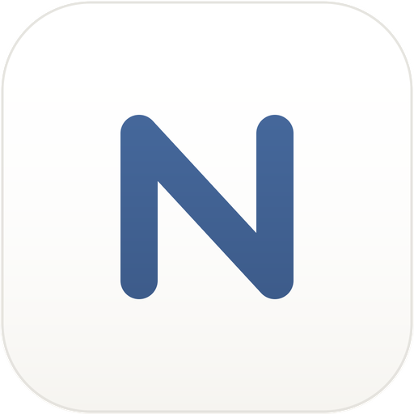
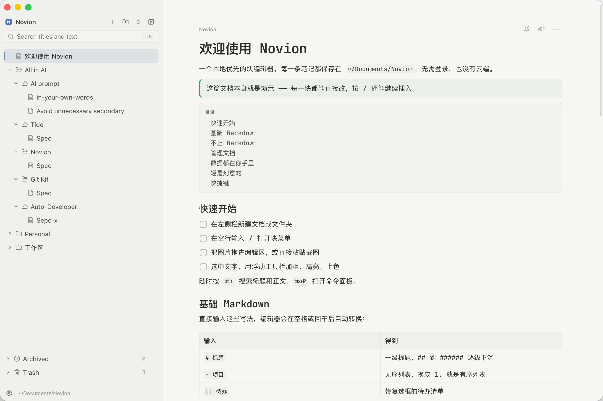

  

<h1 align="center">Novion</h1>

  A local-first desktop note-taking app with Notion sync and iCloud support.

  <b>English</b> · <a href="README.md">简体中文</a>

  <a href="https://github.com/ilemon18/novion/releases">Download</a>

  

## Features

- **Lightweight**: Built with Tauri and the system WebView — no bundled Chromium, low memory, fast startup.
- **Local-first**: No account, no network required. Notes are stored as plain JSON on your machine.
- **Your data, your files**: Everything is ordinary folders and JSON — easy to back up, move, or process with any tool.
- **iCloud sync**: Switch between local storage and iCloud Drive in one click, sync across Macs, merge conflicts instead of losing work.
- **Notion sync**: Folders become sub-pages, documents become pages. One-way or two-way sync; conflicts are never auto-overwritten.
- **Quiet by design**: A restrained interface that stays out of the way of writing.
- **Themes**: Light, dark, or follow the system, with built-in Paper, Catppuccin, GitHub, Rosé Pine and Gruvbox palettes.
- **Search & shortcuts**: Full-text search, command palette, in-document find.
 