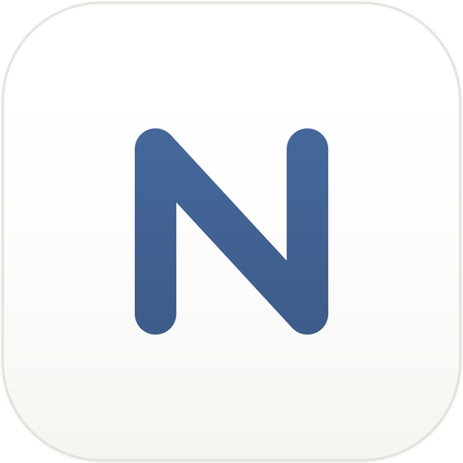

  

<h1 align="center">Novion</h1>

  Local-first notes. Sync with Notion and iCloud.

  <b>English</b> · <a href="README.zh-CN.md">简体中文</a>

  <a href="https://github.com/ilemon18/novion/releases">Download</a>

  

## Features

### Lightweight
Built with Tauri. Fast startup, no bundled Chromium.

### Local-first
Write offline, no account needed. Plain JSON files you own.

### iCloud sync
Keep notes in sync across Macs with iCloud Drive.

### Notion sync
One-way or two-way sync, without overwriting conflicts.

### Distraction-free
A clean writing space with light and dark modes and built-in color themes.

### Search & shortcuts
Full-text search, a command palette, and in-note find.
