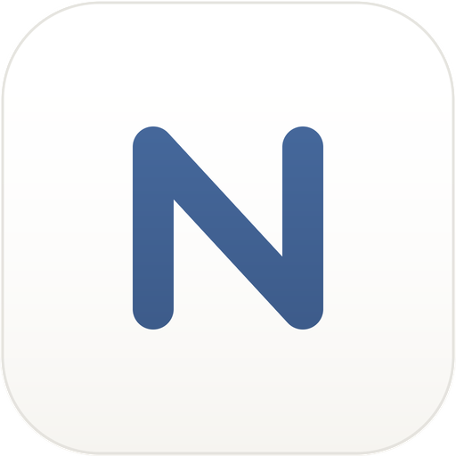
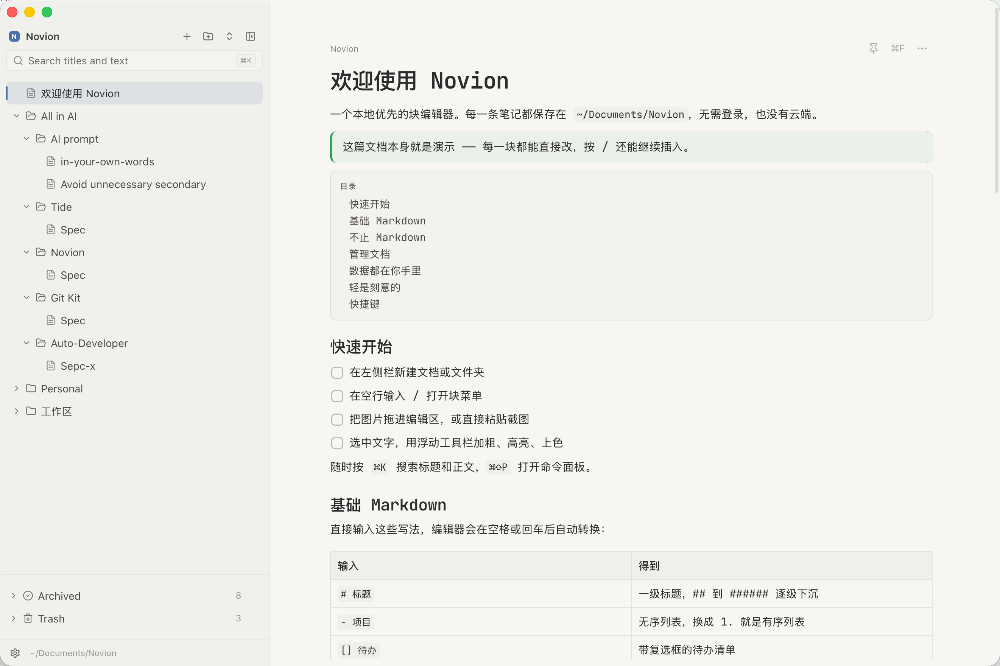

  

<h1 align="center">Novion</h1>

  本地优先的桌面笔记应用，支持 Notion 同步/iCloud。

  <a href="README.en.md">English</a> · <b>简体中文</b>

  <a href="https://github.com/ilemon18/novion/releases">下载</a>

  

## 特性

- **轻量**：基于 Tauri，复用系统 WebView，不内置 Chromium，内存占用低、启动快。
- **本地优先**：无需登录、无需联网，笔记默认以纯 JSON 保存在本机。
- **数据自由**：所有内容都是普通文件夹和 JSON，随时可以备份、迁移，或用任何工具处理。
- **iCloud 同步**：一键在「本机」与「iCloud 云盘」之间切换，多台 Mac 自动同步，冲突可合并。
- **Notion 同步**：文件夹映射为子页面、文档映射为页面，支持单向与双向同步，冲突不自动覆盖。
- **简洁安静**：界面克制，没有多余装饰，专注写作本身。
- **多种主题**：浅色、深色或跟随系统，内置 Paper、Catppuccin、GitHub、Rosé Pine、Gruvbox 等配色。
- **搜索与快捷键**：全文搜索、命令面板、页内查找。
 