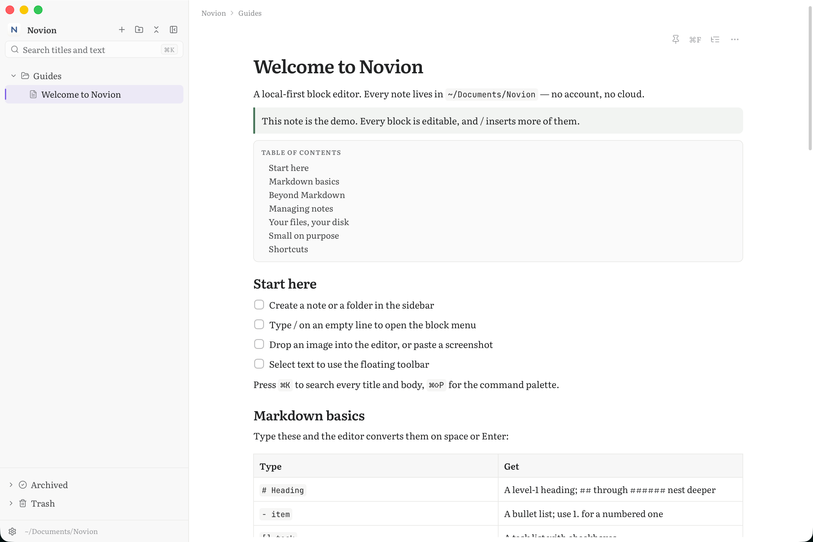

  

<h1 align="center">Novion</h1>

  Local-first notes. Sync with Notion and iCloud.

  <b>English</b> · <a href="README.zh-CN.md">简体中文</a>

  <a href="https://github.com/ilemon18/novion/releases">Download</a>

  

## Features

### Lightweight
Built with Tauri. Fast startup, no bundled Chromium.

### Local-first
Write offline, no account needed. Plain JSON files you own.

### iCloud sync
Keep notes in sync across Macs with iCloud Drive.

### Notion sync
A one-way mirror from Novion to Notion: local folders and notes are authoritative, archived notes live in their own folder page, and notes deleted locally are removed from Notion. If the sync target is moved to the Notion trash it is restored automatically; when that is impossible a replacement page is created and everything is pushed again. A force push rewrites every page from Novion.

See [docs/notion.md](docs/notion.md) for the mirror rules and recovery behavior.

### LAN sharing
Share a workspace with another Novion on the same network. The host keeps the files; the connected computer edits them directly over a paired, TLS-protected connection. Off by default.

See [docs/sharing.md](docs/sharing.md) for setup, security, and limitations.

### MCP
Let local AI clients search, read and edit notes through an optional MCP server that listens on your computer only. No token is required by default; enable token authentication in settings when needed.

See [docs/mcp.md](docs/mcp.md) for client setup and the full tool reference.

### Distraction-free
A clean writing space with light and dark modes and built-in color themes.

### Search & shortcuts
Full-text search, a command palette, and in-note find.

## Documentation

- [Development](docs/development.md)
- [LAN sharing](docs/sharing.md)
- [MCP server](docs/mcp.md)
