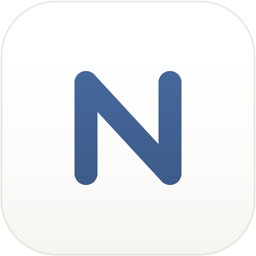
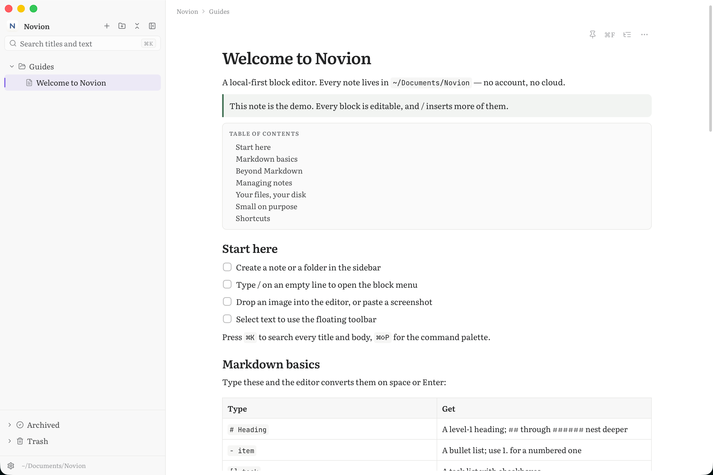

  

<h1 align="center">Novion</h1>

  本地优先的笔记应用，支持 Notion 与 iCloud 同步。

  <a href="README.md">English</a> · <b>简体中文</b>

  <a href="https://github.com/ilemon18/novion/releases">下载</a>

  

## 特性

### 轻量快速
基于 Tauri，启动快，无需内置 Chromium。

### 本地优先
无需账号，离线可用，数据以普通 JSON 文件保存。

### iCloud 同步
通过 iCloud 云盘，在多台 Mac 间同步笔记。

### Notion 同步
支持单向与双向同步，不自动覆盖冲突。

### 专注写作
简洁的写作空间，支持浅色、深色与多种主题配色。

### 搜索与快捷键
全文搜索、命令面板与页内查找，快速定位内容。
